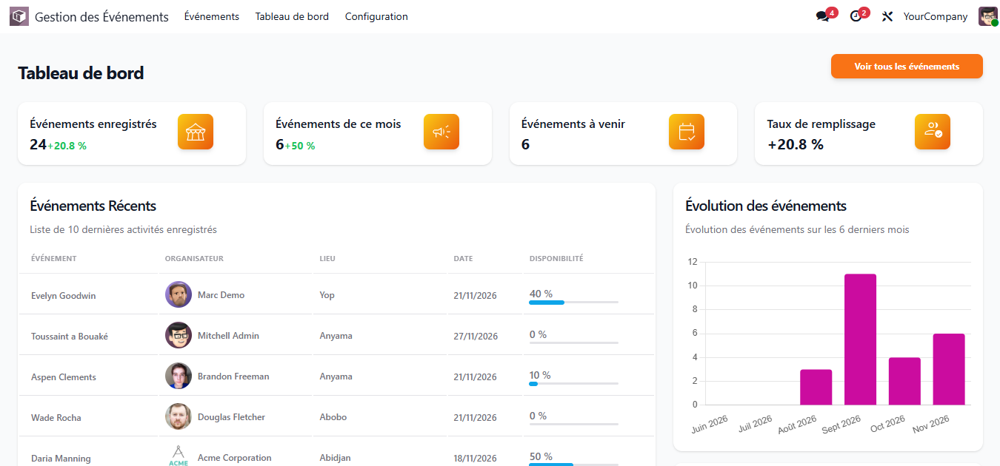
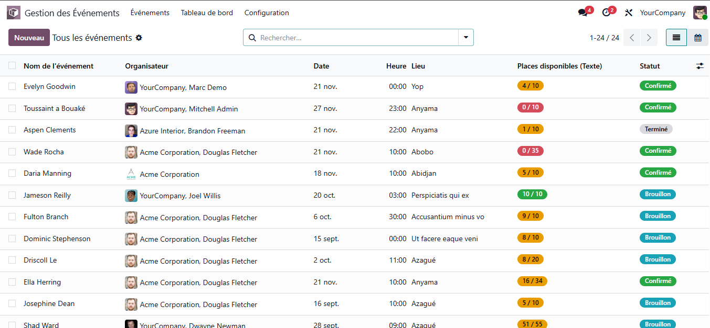
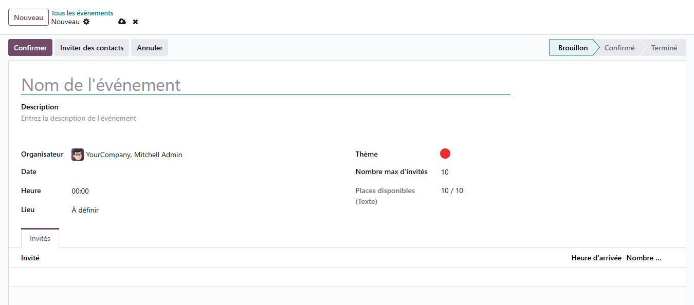
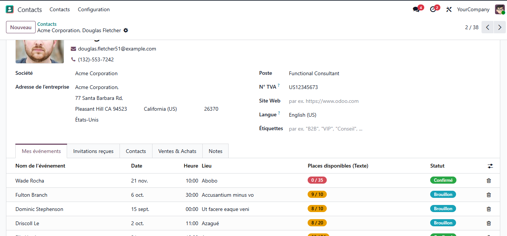

# Fiesta — gestion d’événements avec Odoo

Fiesta est un environnement Odoo 19 conteneurisé, accompagné du module personnalisé [`event_manager`](custom-addons/event_manager/__manifest__.py). Il permet d’organiser des événements depuis les fiches contacts, de gérer les invitations, de suivre les capacités et confirmations, et de visualiser l’activité sur un tableau de bord dédié.

## Aperçu

Les captures d’écran et illustrations du projet sont stockées dans [`docs/screenshots/`](docs/screenshots/).







## Fonctionnalités

- **Gestion des événements (`fiesta.event`)** : organisateur, date, heure, lieu, thème, capacité maximale (`>= 4`), suivi des messages (`mail.thread`) et cycle de vie (`Brouillon` → `Confirmé` → `Terminé` / `Annulé`).
- **Gestion des invitations (`fiesta.event.invitation`)** : contrôle d’unicité par événement et contact, vérification des places disponibles, déclaration de l’heure d’arrivée et du nombre d’accompagnants.
- **Assistants dédiés** : ajout en lot de contacts non encore invités (`add.contact.to.event.wizard`) et saisie des informations d’arrivée d’un invité (`add.guest.info.to.event.wizard`).
- **Intégration Contacts (`res.partner`)** : accès aux événements organisés et aux invitations reçues directement depuis la fiche contact.
- **Tableau de bord OWL (`fiesta.event.dashboard`)** : indicateurs clés, évolution mensuelle sur 6 mois et liste des 10 derniers événements créés.
- **Réglages & sécurité** : paramétrage du délai limite de confirmation (`event_manager.confirmation_days`, 5 jours par défaut) et de la marge d’heure d’arrivée (`event_manager.arrival_time_buffer`, 2 heures par défaut) ; droits cloisonnés entre utilisateurs internes (organisateurs / invités) et responsables événements (`event_manager.group_event_manager`).

## Technologies

- Odoo 19 (version déclarée par le module)
- PostgreSQL (version sélectionnée par configuration)
- Docker Compose
- Python, XML, JavaScript (OWL) et SCSS pour le module Odoo

## Structure du dépôt

```text
.
├── compose.yaml
├── docs/
│   └── screenshots/
├── odooconf/
│   └── odoo.conf
├── custom-addons/
│   └── event_manager/
├── requirements.txt
└── README.md
```

## Prérequis

- Docker Desktop (ou Docker Engine) avec le plugin Docker Compose
- Un fichier `.env` à la racine du dépôt, configuré selon les variables utilisées dans [`compose.yaml`](compose.yaml)
- Un dossier d’addons Enterprise valide si vous utilisez le montage Enterprise défini dans Compose

## Démarrage local

1. Créez un fichier `.env` à la racine. Exemple de configuration locale à adapter :

   ```dotenv
   ODOO_VERSION=19.0
   POSTGRES_VERSION=15
   ODOO_CONTAINER_NAME=fiesta-odoo
   DB_CONTAINER_NAME=fiesta-db
   ODOO_PORT=8069
   POSTGRES_DB=postgres
   POSTGRES_USER=odoo
   POSTGRES_PASSWORD=odoo
   CONFIG_PATH=./odooconf
   ADDONS_PATH=./custom-addons
   ENTREPRISE_PATH=./enterprise-addons
   ```

   `CONFIG_PATH`, `ADDONS_PATH` et `ENTREPRISE_PATH` doivent pointer vers des dossiers accessibles à Docker. Si vous n’avez pas les addons Enterprise, créez un dossier local vide pour le montage ou adaptez `compose.yaml` pour retirer ce volume. L’exemple `POSTGRES_PASSWORD=odoo` correspond à la valeur `db_password` de `odooconf/odoo.conf` et ne convient qu’à un environnement local isolé. Si vous changez les identifiants PostgreSQL, mettez aussi à jour les paramètres `db_user` et `db_password` d’Odoo. Ne publiez jamais votre fichier `.env`.

2. Démarrez Odoo et PostgreSQL :

   ```powershell
   docker compose up -d
   docker compose ps
   ```

3. Ouvrez [http://localhost:8069](http://localhost:8069) (ou le port choisi avec `ODOO_PORT`) et créez une base de données Odoo. Notez son nom : les commandes ci-dessous doivent cibler cette base.

4. Dans Odoo, activez le mode développeur, mettez à jour la liste des applications, recherchez **Event Manager** et installez l’application.

Les données de PostgreSQL et les fichiers Odoo sont conservés dans les volumes Docker déclarés dans Compose. Pour arrêter les services sans supprimer les données :

```powershell
docker compose stop
```

Pour arrêter et supprimer les conteneurs :

```powershell
docker compose down
```

> `docker compose down -v` supprime également les volumes et donc les données persistantes. À utiliser uniquement si vous souhaitez réinitialiser l’environnement.

## Mettre à jour le module

Après une modification du code, remplacez `ma_base_odoo` par le nom de votre base, puis mettez à jour `event_manager` et redémarrez le service :

```powershell
docker compose exec odoo odoo -c /etc/odoo/odoo.conf -d ma_base_odoo -u event_manager --stop-after-init
docker compose restart odoo
```

Vous pouvez aussi mettre à jour le module depuis l’interface des applications Odoo.

## Tests

Pour exécuter la suite de tests unitaires du module [`test_event_manager.py`](custom-addons/event_manager/tests/test_event_manager.py) :

```powershell
docker compose exec odoo odoo -c /etc/odoo/odoo.conf -d ma_base_odoo -u event_manager --test-tags /event_manager --stop-after-init
```

## Sécurité avant publication

- Le fichier `.env` contient la configuration locale et des identifiants : ne le commitez pas.
- Changez également `admin_passwd` dans [`odooconf/odoo.conf`](odooconf/odoo.conf) avant d’exposer l’instance ; coordonnez tout changement d’identifiants PostgreSQL avec la configuration Odoo.
- Évitez les identifiants par défaut en dehors d’un environnement local isolé.
- Le module accorde des droits de modèle larges dans [`ir.model.access.csv`](custom-addons/event_manager/security/ir.model.access.csv) encadrés par des règles d’enregistrement dans [`event_security.xml`](custom-addons/event_manager/security/event_security.xml) ; vérifiez les droits nécessaires avant un déploiement en production.
